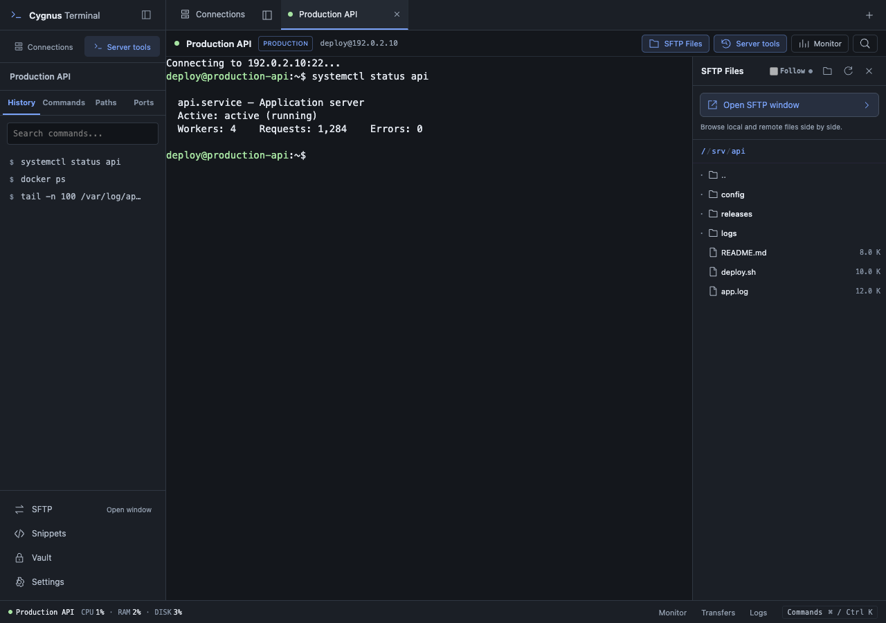
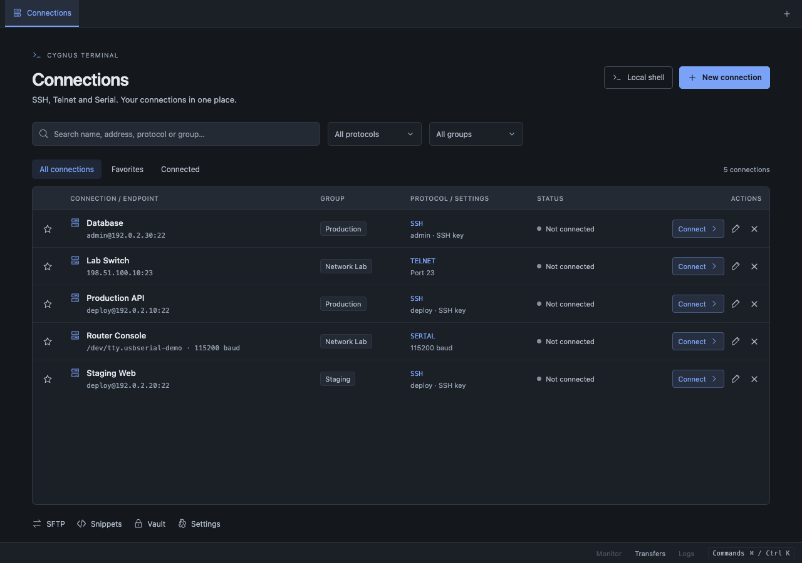
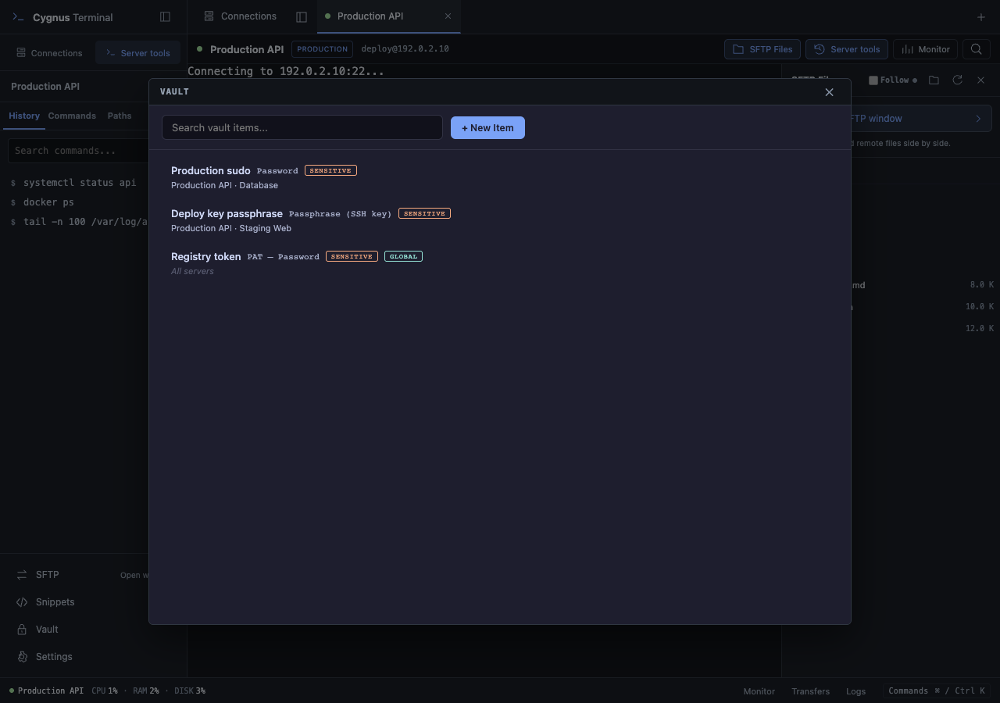
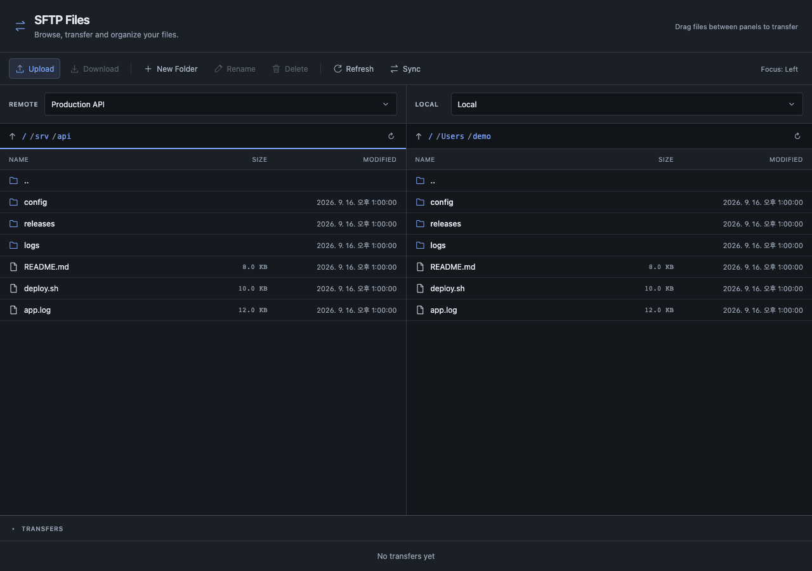

<div align="center">
  
  <h1>Cygnus Terminal</h1>
  <p><strong>Connect to servers, move files, and remember your workflow.</strong></p>
  <p>Rust · Tauri 2 · SSH · WinRM · Telnet · Serial · SFTP · Credential Vault</p>
  <p><a href="README.md">한국어</a> · <strong>English</strong></p>
  <p><a href="https://github.com/cygnus970209/cygnus-terminal/releases/latest">Download</a> · <a href="#features">Features</a> · <a href="#roadmap">Roadmap</a> · <a href="CHANGELOG.md">Changelog</a></p>
</div>



Cygnus is a desktop terminal for people working across servers and network equipment. Keep connections, per-server command history, saved commands, paths, and credentials in one place.

**A Rust backend and Tauri's system WebView** keep the architecture lightweight without bundling a separate Chromium runtime. Cygnus is designed to reduce memory overhead; actual usage depends on the OS, open sessions, and workload. No comparative memory benchmark is claimed here.

> Screenshots use synthetic demo servers, files, and credential metadata. The workspace image predates v0.1.15's removal of the Connections tab, tab pinning, and history actions. The Vault image predates the v0.1.13 redesign.

## Features

| Your task | What Cygnus provides |
| --- | --- |
| Connect to servers and devices | SSH, Telnet, Serial, local shells, and RDP (Beta) in one tabbed workspace |
| Reconnect quickly | Saved connections, reusable groups, favorites, search, and filters |
| Enter credentials | Encrypted Vault, server mappings, and credential selection at SSH prompts |
| Manage files | Dedicated SFTP window, local/remote panels, server-to-server transfers, and transfer progress |
| Repeat commands | Per-SSH-server history, command/path bookmarks, and shared snippets |
| Inspect operations | CPU, memory and disk monitoring, multiple log streams, and SSH local forwarding |

## Start with organized connections



- **SSH**: password/key authentication, Jump Host, Agent Forwarding, and host-key verification.
- **RDP (Beta)**: save Windows desktop connections through **New connection → RDP (Beta)**, then search, favorite, connect, edit, or delete them in the same library.
- **Telnet**: access legacy servers and network equipment.
- **Serial**: save COM/TTY paths and baud rates, even before a device is plugged in.
- **Local Shell**: open a local terminal tab when you need one.

Once a group is saved with an SSH, Telnet, or Serial connection, select it from the list next time. Use protocol/group filters and favorites to find a connection, then choose **Save** or **Save & Connect**. RDP connections do not currently have group assignments.

Drag tabs to reorder them, or right-click for **Close other tabs / Close tabs to the left / Close tabs to the right / Pin tab**. **F10** toggles the active tab’s pin (**Fn+F10** on some Mac keyboards). Pinned tabs stay on the left and survive bulk closing; their close button or **Close tab** still closes them directly. Dragging reorders within the pinned or regular group. Focus a tab and press **Shift+F10** to open its menu with the keyboard.

Open Connections from **Connections** at the bottom of the sidebar or **Open Connections** in the command palette. The panel button at the left of the tab strip collapses or expands the sidebar. Returning to Connections keeps sessions open.

## WinRM connections

Use **New connection → WinRM**, the tab **+ → WinRM connection**, or **Connection → New WinRM Connection** to add a Windows management connection. The target needs a WinRM listener, account permissions, and firewall configuration independently of SSH. See [Microsoft’s setup documentation](https://learn.microsoft.com/en-us/windows/win32/winrm/installation-and-configuration-for-windows-remote-management).

- Defaults: **HTTPS / 5986 / NTLM**. HTTP / 5985 uses NTLM message encryption and is intended for trusted networks. Basic is restricted to HTTPS and must also be enabled on the server. Kerberos and CredSSP are not currently exposed.
- Enter the domain separately from the username. HTTPS validates certificates against system trust. For a self-signed listener, optionally enter its independently verified SHA-256 fingerprint. A pin directly trusts that certificate and must be updated when it changes.
- Saved passwords use the app’s existing encrypted storage; you may also leave the password unsaved and enter it at connection time. An empty password while editing preserves the existing one unless the endpoint, account, or transport changes. Backups omit passwords and certificate pins.
- Write a PowerShell script and press **Run script** or **Ctrl/⌘+Enter**. Stop, disconnect, and closing the tab request remote command termination and shell cleanup. Cleanup cannot be guaranteed after network loss.
- Each run starts a new non-interactive PowerShell process. Variables and the current directory do not persist; interactive prompts, full-screen applications, and SFTP are unavailable. Execution is limited to five minutes and 1 MiB of output, with the last five runs kept in the tab.

## Menus and language settings

Use **Connection** in the menu bar for SSH, local shell, RDP, WinRM, Telnet, and Serial sessions. **Tools** provides SFTP, Snippets, Vault, MCP settings, and the command palette. **Esc** closes the top dialog or open selection list. Host-key and permission prompts reject the request.

Choose English or 한국어 in **Settings → General → Language**. Changes apply immediately across windows and persist on restart. The initial language follows the system preference, using English for languages other than Korean. Server output and user data remain unchanged.

## A Vault that knows your servers



Choose the right credential for a server instead of copying passwords into your terminal.

- Manage passwords, SSH key passphrases, SSH keys, and PAT username/token entries.
- Link a credential to multiple servers and control its scope.
- Search credentials and linked servers, filter by type, and edit items in the same window with confirmation before deletion. Leave the secret field empty when editing to retain its existing value.
- Detect `sudo`, password, passphrase, and Git HTTPS password prompts in SSH sessions and offer matching credentials. Configure patterns in **Settings → Autofill**.
- Local secret values use **AES-256-GCM encryption**, with the master key managed through the operating system's credential store.
- **Vault injection decrypts in Rust and writes directly to the SSH channel.** That operation does not return the decrypted password to the UI or copy it to the clipboard.

Secret injection currently supports SSH and locally stored Cygnus items. External password-manager integration is not advertised as a shipped capability.

The default password pattern, `[Pp]assword(?: for '[^'\r\n]+')?:\s*$`, recognizes both `Password:` and `Password for 'https://user@github.com':`. Existing default rules are upgraded while custom patterns, deleted rules, and disabled states are preserved. A manually added `[Pp]assword:\s*$` pattern does not allow the `for '…'` portion; update it to recognize Git HTTPS prompts.

Startup and list views do not access the keychain. The first operation requiring the encryption key shows an explanation before **Continue** requests OS access. On macOS, **Always Allow** avoids repeated approval for that Cygnus keychain item. Remembering the explanation does not grant OS permission. If you choose **Allow** only, macOS may ask again after restarting the app without repeating the Cygnus explanation. Changes to the app signature or keychain permissions may require approval again even after Always Allow. [Apple’s keychain access guide](https://support.apple.com/guide/keychain-access/kyca1243/mac)

If keychain access is denied, Cygnus reopens its explanation. Choose **Retry access** to request permission again or **Cancel** to stop the operation. The next access attempt shows the explanation again after cancellation. Termius imports use a separate explanation.

## Give file transfers their own workspace



Click **SFTP Files** above the terminal to open the right-hand file panel. Its visible **Open SFTP window** button takes you directly to a larger file workspace.

- Choose local storage or a remote server on either side, including **server-to-server transfers**.
- Drag and drop, multi-select, upload/download, rename, and create folders.
- Track progress and speed, cancel transfers, and resolve filename conflicts with Replace, Skip, or Keep Both.
- Compare and synchronize local/remote folders with a preview before execution.
- Open remote files in a local editor and automatically upload saved changes.

## Keep each server's working context

For saved SSH connections, the left-hand **Server tools** panel keeps frequent tasks close:

- **History**: search past commands, run them again, or right-click to copy the full command or save it to Commands. **Delete all…** asks for confirmation before deleting this server's entire history, including entries hidden by search.
- **Commands**: bookmark health checks, restarts, and deployment commands.
- **Paths**: bookmark frequently used directories.
- **Ports**: manage SSH local port forwarding.

Shared **Snippets**, a `⌘/Ctrl K` command palette, and resizable panels reduce repetitive work. Automatic directory tracking runs **only when a shell sends OSC 7 directory information**; Cygnus never inserts `pwd` into your session.

Monitoring and log viewing use separate SSH channels. Check server resources and multiple log streams while continuing your terminal work.

Terminal typing, pasted text, and saved-command execution **convert non-breaking spaces (U+00A0) to regular spaces**. This prevents commands such as `sudo su` from being read as a single command name. The conversion also applies inside quoted text.

In regular and MCP terminals, paste with `⌘V` on macOS or `Ctrl+V`, `Ctrl+Shift+V`, or `Shift+Insert` on Windows/Linux. The right-click menu provides **Copy / Paste**. Copy uses `⌘C` on macOS and `Ctrl+Shift+C` on Windows/Linux; `Ctrl+C` remains an interrupt.

## Connect AI clients through MCP

Settings → MCP lets you share selected SSH profiles with a local MCP server.
AI clients can list servers and, when command execution is enabled, submit jobs,
inspect results, and request cancellation. **OAuth app approval (Beta)** registers only the URL:
match the browser's verification code in Cygnus and approve. Clients renew tokens automatically;
approvals survive restarts and can be revoked individually under **Authorized clients**.
MCP is disabled on app restart and requires consent to start again. Manual bearer tokens remain available.
See the [setup and tool reference (Korean)](docs/guides/mcp.md).
Separate SFTP read and change permissions enable listing, metadata, reading, writing,
directory creation, renaming, and deletion. File content is limited to 64 KiB per request
and is not stored in Cygnus execution history.

Settings → Data → Execution history controls recording, retention, and deletion. Recording is off on fresh installs; enabling it keeps unencrypted commands and output for 7 days by default.

## Install

Download an installer from the [latest release](https://github.com/cygnus970209/cygnus-terminal/releases/latest).

| Platform | Distribution |
| --- | --- |
| macOS · Apple Silicon | `.dmg`, Developer ID signed and notarized |
| Windows · x64 | `.msi` or `.exe`, currently without Windows code signing |

Installed apps check GitHub Releases for updates. Linux and Intel Mac installers are not part of the current release matrix.

Starting with v0.1.13, Cygnus uses a personal-project application identifier. Existing connection/Vault database contents and the encryption key migrate while retaining the originals; some UI preferences, such as themes and favorites, may need to be set again. [Application identity and migration details](docs/guides/app-identity.md#english)

Export/import connections and command/path bookmarks as JSON. This is not a full backup: passwords, Vault items, and snippets are not included.

## Moving from another terminal

Use **Import connections** in Connections to preview and import OpenSSH configuration or iTerm2 profiles (JSON/plist). Local source detection, duplicate skipping and unsupported-setting warnings are included. Experimental direct import from Termius 10.1.0 local storage is also available on macOS. Passwords and private key contents are not migrated. [Supported formats and instructions](docs/guides/connection-import.md#english)

## Roadmap

**Next: advanced operations across multiple servers.**

We plan Ansible-style workflows for running commands, applying configuration changes, and deploying to server groups, with per-server results. These capabilities are not included in the current version; scope and timing will be announced later.

## Development

Tauri 2 connects a React, TypeScript, and xterm.js frontend to the Rust backend. Application data is stored locally in SQLite.

Use Rust 1.98.0 (pinned in `rust-toolchain.toml`), Node.js 22.12+, and the platform-specific Tauri build prerequisites. The examples below use Bun as the package manager.

```sh
bun install --frozen-lockfile
bun run tauri dev

# Validate
bun run build
bun run test
bun run rdp:build # Prepare the RDP engine before invoking Cargo directly
bun run rdp:test
cargo test --manifest-path src-tauri/Cargo.toml --locked

# Build installers
bun run tauri build
```

Choose **New connection → RDP (Beta)**, then **Save** or **Save & Connect**. Saved RDP connections support search, favorites, connecting, editing and deletion in Connections and the sidebar. The tab bar's `+ → RDP desktop (Beta)` menu is also available. Save named connections with the server, username, domain, desktop size, and Windows scale (DPI) in the RDP connection form; edit them or save a copy. Direct NLA/NTLM connections, display rendering, and basic US keyboard and mouse input are supported. The IIS viewer is also labeled Beta while Windows server validation is pending.

Verify the certificate's SHA-256 fingerprint before entering your password. Remembering it is optional. If a saved fingerprint changes, compare both fingerprints and explicitly acknowledge the change before continuing. Automatic issuer, hostname, and validity checks are not supported yet. Passwords are neither saved nor exposed to MCP. Backup v5 includes RDP scale settings but excludes certificate trust; v1–v4 backups remain importable. Existing connections without a scale setting use the server default.

Use `Reconnect` in the connected toolbar or after a connection ends/fails to reuse the last server, account, resolution, and DPI settings in the same tab. Separate edits in the connection form are kept. The previous connection must finish closing before a replacement starts, and each attempt requires a fresh certificate review and password entry. Passwords are not reused and reconnect is manual.

After connecting, open `Text input / 한글`, compose with your local IME, and click `Send text` to type into the focused remote field. Composition keys and Enter are not forwarded. Text is not recorded; drafts are cleared after sending, closing, switching tabs, or leaving the app. Single-line text is limited to 256 UTF-16 units and control characters are rejected. Remote applications may handle Unicode input differently. Inline IME composition directly on the remote canvas is not supported yet.

`Fit to window` follows the window size; `1:1 pixels` accounts for monitor DPI to map remote pixels to physical display pixels. Connection resolution is limited to 1920 × 1080. Windows scale is requested when connecting; the server may retain an existing session’s scale. Windows installers are built in CI; installed-app behavior and real Windows server connections still need broader validation. RD Gateway is not supported yet.

When the server enables Display Control, use `Remote resolution → Apply resolution` while connected (up to 1920 × 1080, within the server’s limits). Remote input pauses during the change and the display follows the size confirmed by the server. If the server ignores the request, a notice appears after 15 seconds and the connection stays open. Saved profiles and the initial settings used for reconnect remain unchanged. RemoteFX is not advertised, following [Microsoft’s Display Control prerequisites](https://learn.microsoft.com/en-us/openspecs/windows_protocols/ms-rdpedisp/2878b488-794e-42c1-8f98-a23fa950def8); display traffic may increase.

The `Clipboard` panel requires explicit permission for each session. Use `Load local clipboard` to review/edit text before `Send to remote clipboard`, or copy in the remote app and use `Read remote clipboard → Copy preview locally`. Allowing sharing may clear the remote clipboard, so copy remote text after allowing. There is no automatic synchronization, automatic paste, file transfer, or image sharing. Plain text is limited to 2048 UTF-16 units, with line breaks and tabs allowed. Review multiline commands before pasting into a terminal. Closing the panel, switching tabs, leaving the app, or reconnecting revokes sharing and clears previews; data already received by the other computer cannot be recalled. Clipboard contents are not stored in profiles, backups, execution history, or MCP. Cancelling a pending request or receiving no response within 10 seconds locks the clipboard until reconnect to prevent late-response mix-ups; the desktop connection stays open.

The RDP engine is a separate Cargo project bundled with the app to avoid conflicting SSH cryptography dependencies. `tauri dev/build` prepares it automatically; the app communicates with it over local pipes. Run `rdp:build` first when invoking Rust tests or `cargo check` directly.

Report bugs and suggest features through [Issues](https://github.com/cygnus970209/cygnus-terminal/issues).

Developer notes (Korean): [shared SSH execution API](docs/guides/execution-engine.md) · [input investigation and remaining issues](docs/investigations/terminal-input-2026-09-18/README.md) · [window restoration and reproduction](docs/investigations/terminal-resize-2026-09-22/README.md). Also see [screenshot fixtures](docs/media/README.md).

[MIT License](LICENSE)
